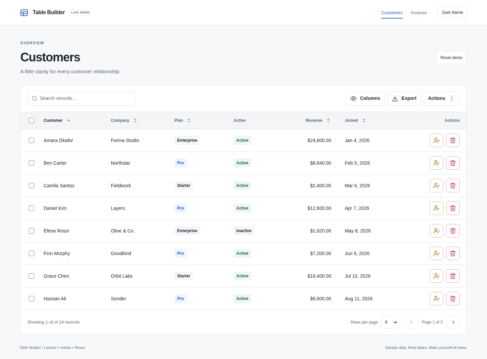
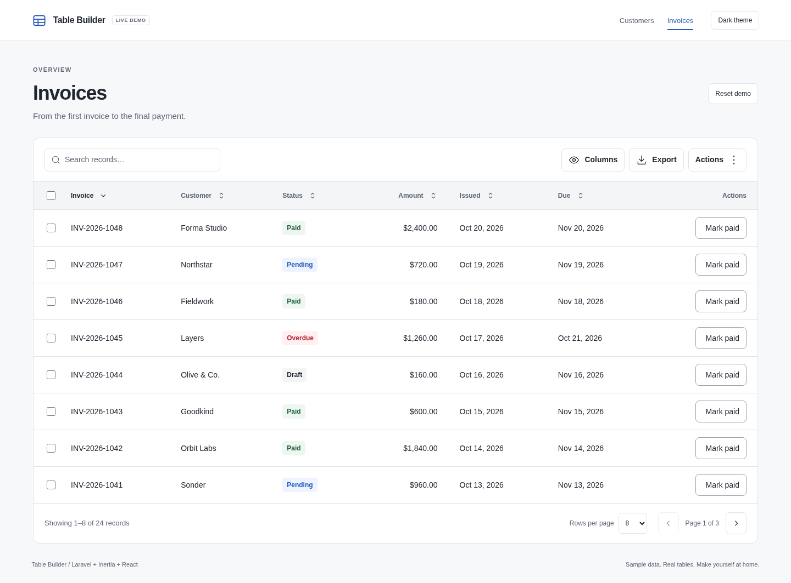
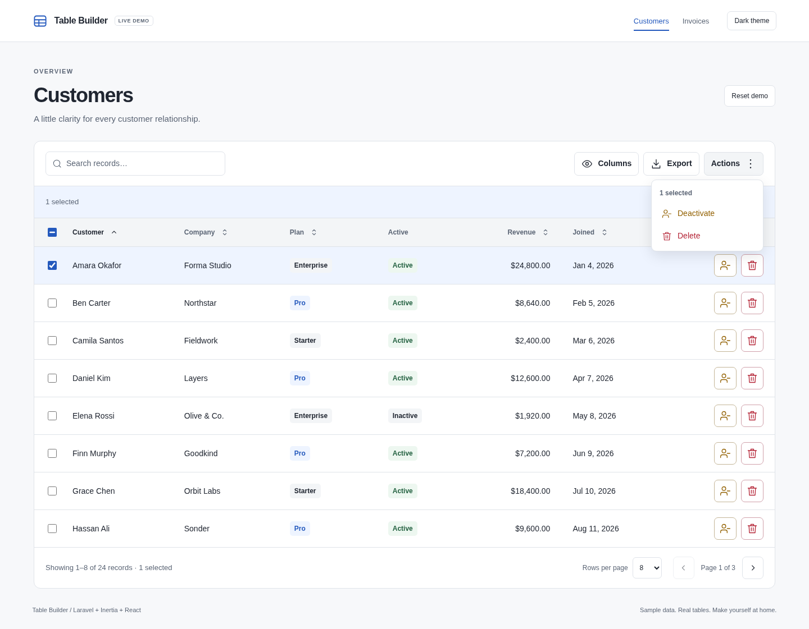
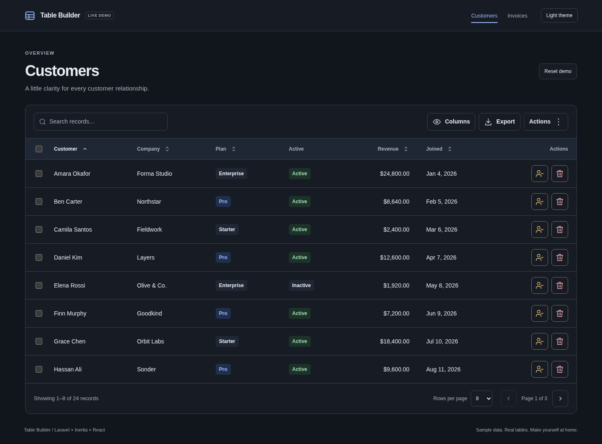
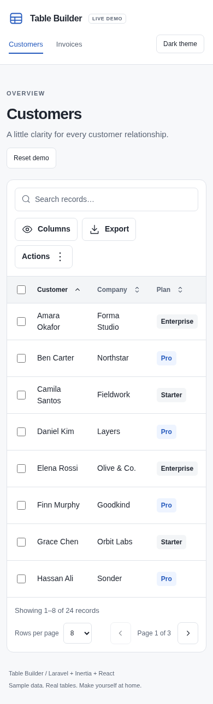

# Table Builder

Eloquent-backed tables for Laravel, Inertia.js and React. Define a table with a fluent builder or PHP class, then render it with the supplied React component or Inertia page. Includes search, sorting, column visibility, pagination, selection, policy-checked actions and spreadsheet exports.



Real browser screenshots of the [local Laravel/SQLite demo](docs/demo.md), built with the package's PHP definitions and shipped React components using deterministic sample data.

<details>
<summary>See invoices, bulk actions, dark mode, and mobile</summary>

An invoice table with payment status badges, sortable amounts and dates, and row actions:



Row selection and the bulk action menu:



The customer table in dark mode:



On mobile, controls wrap and the table scrolls horizontally:



</details>

Requires PHP 8.5 and Laravel 13 in an application already configured for Inertia and React. Supported frontend combinations are React 18/Inertia 2 and React 19/Inertia 2 or 3.

## Try the demo locally

From a clone of this repository, run:

```sh
composer install
npm ci
npm run demo
```

Open [localhost:4176](http://127.0.0.1:4176). Explore Customers and Invoices, search and sort records, change visible columns, select rows, run actions, and download CSV or Excel files. The demo uses the package's React components and PHP handlers with a seeded SQLite database. Use **Reset demo** to restore the sample data.

See the [demo guide and screenshot gallery](docs/demo.md) for dark mode, mobile, setup details and screenshot regeneration.

## Quick start

Releases are available through GitHub. Add the Composer VCS repository and install in your application:

```sh
composer config repositories.table-builder vcs https://github.com/wtroiano86/table-builder.git
composer require wtroiano/table-builder:^1.0
php artisan vendor:publish --tag=table-builder-react
php artisan vendor:publish --tag=table-builder-react-page
```

In a controller receiving `$request`, define the table and return the supplied page. This example assumes an existing `User` model and `viewAny` policy:

```php
use App\Models\User;
use Illuminate\Http\Request;
use Inertia\Inertia;
use Wtroiano\TableBuilder\Columns\TextColumn;
use Wtroiano\TableBuilder\TableBuilder;

$table = TableBuilder::make('users')
    ->resource(User::class)
    ->authorize(fn (Request $request): bool => $request->user()?->can('viewAny', User::class) ?? false)
    ->columns([
        TextColumn::make('name', sortable: true, searchable: true),
        TextColumn::make('email'),
    ])
    ->defaultSort('name')
    ->build();

abort_unless($table->authorize($request), 403);

return Inertia::render('vendor/table-builder', ['table' => $table, 'title' => 'Users']);
```

Add your authenticated page route and run `npm run build`. The page publishes under `resources/js/pages`; move it into `Pages/vendor` if your resolver uses uppercase `Pages`. The [complete getting-started example](docs/consumers/getting-started.md) includes the controller, route and setup requirements.

## Documentation

| Audience | Start here |
| --- | --- |
| Application consumers | [Getting started](docs/consumers/getting-started.md) · [All consumer guides](docs/README.md#consumers) |
| Package developers | [Contributing](CONTRIBUTING.md) · [Testing](docs/development/testing.md) · [Architecture](docs/architecture.md) |
| Agents in consuming apps | [Laravel Boost setup and shipped skills](docs/boost.md) |
| Agents changing this package | [Contributor agent workflow](docs/development/agent-workflow.md) |

Consumer references: [Tables](docs/consumers/tables.md), [Columns](docs/consumers/columns.md), [React customization](docs/consumers/react.md), [State and pagination](docs/consumers/state-and-pagination.md), [Actions](docs/consumers/actions.md), [Exports](docs/consumers/exports.md), [HTTP contract](docs/consumers/http-contract.md), [Troubleshooting](docs/consumers/troubleshooting.md).

Register a fresh table factory before adding executable actions or exports so later requests and queue workers can reconstruct it. The application owns page policies, tenant scoping and published UI customizations. The package's React sources use neutral, responsive light/dark styling with configurable CSS variables and no additional UI dependency.

Licensed under the [MIT license](LICENSE).
